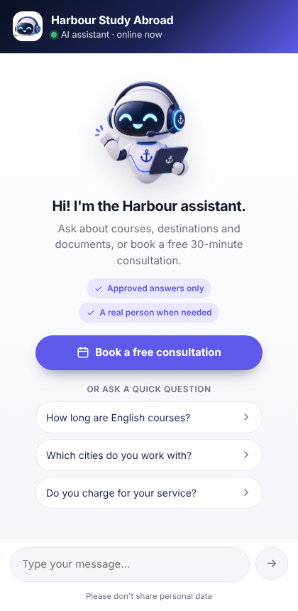
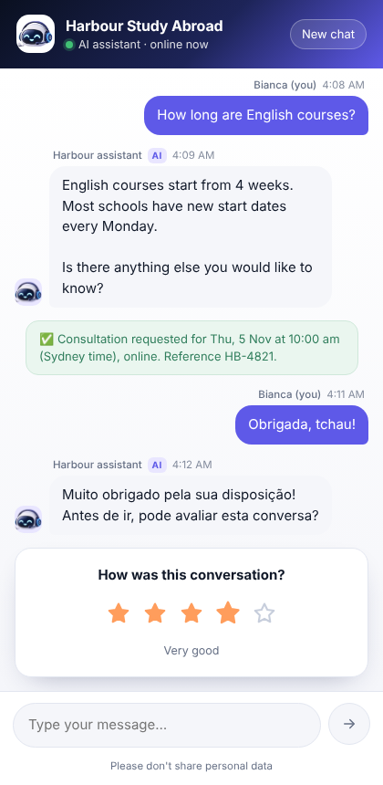
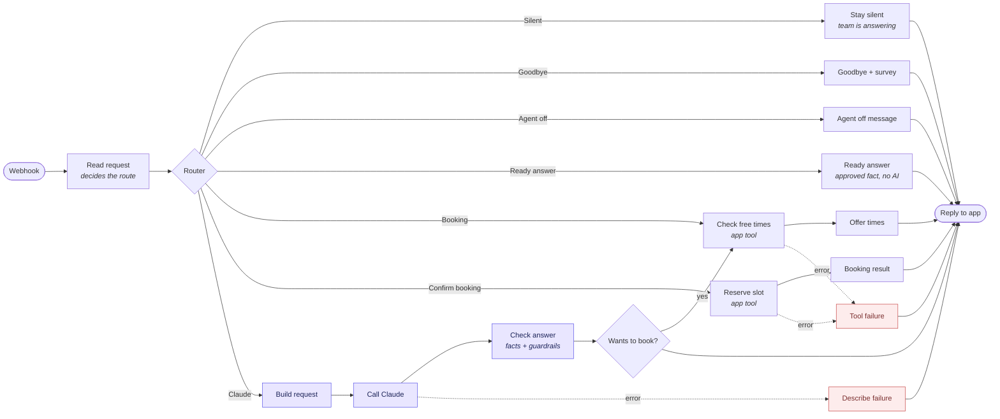
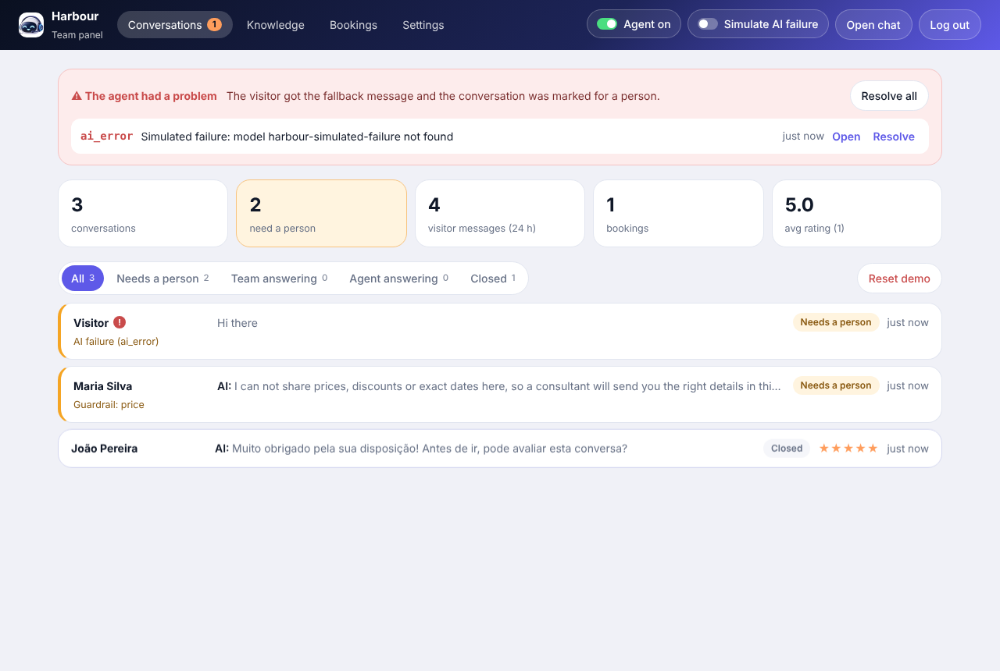
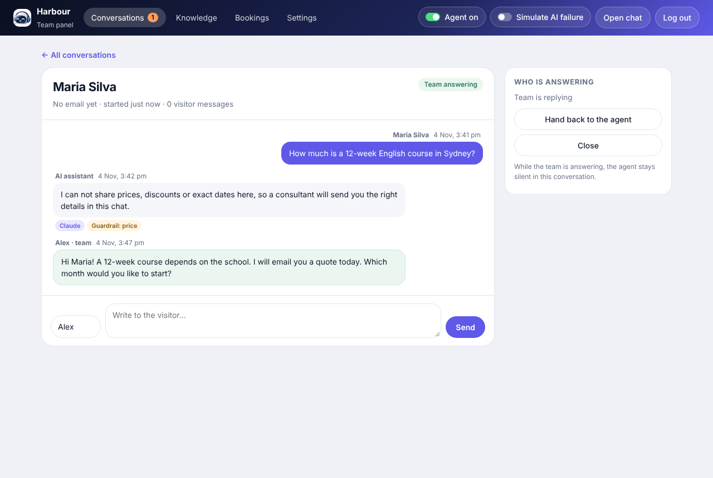
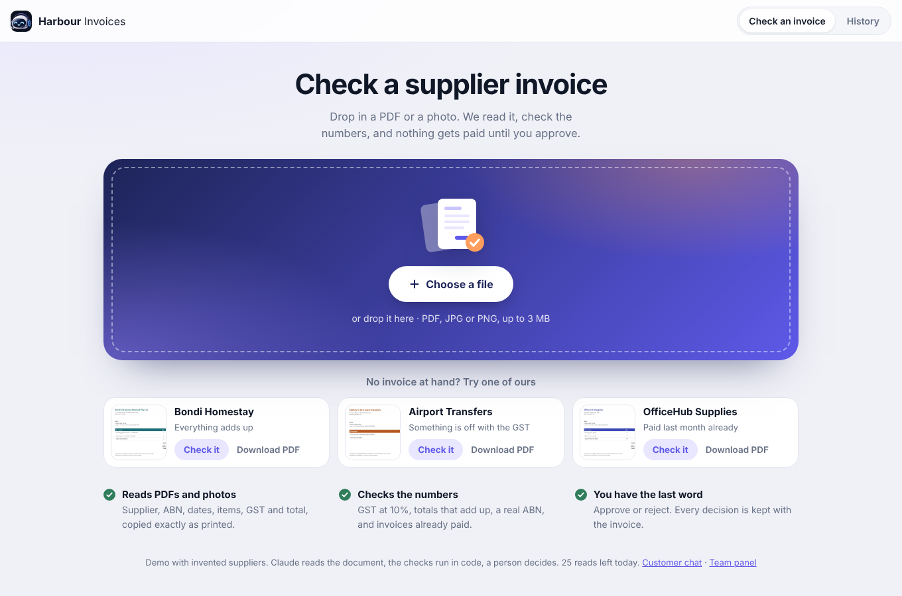

# Harbour Study Abroad · AI support agent (demo)

A customer-support agent for an invented study-abroad agency in Sydney. It answers **only from approved facts**, books consultations, hands over to a person when it should, and keeps working when the AI fails.

| | Link |
| :-- | :-- |
| Chat (what a visitor sees) | https://harbour-demo-theta.vercel.app |
| Team panel | https://harbour-demo-theta.vercel.app/admin (password sent separately) |
| Invoice reader (accounts payable) | https://harbour-demo-theta.vercel.app/invoices |
| Health check | https://harbour-demo-theta.vercel.app/api/health |

Harbour Study Abroad, its address, facts and people are invented for this demo. Please don't type real personal data.

<p>
  
  
</p>

---

## What it does

- **Answers only from approved facts.** Every answer cites the fact codes it used (`F07`, `F20`...). The workflow checks those codes in code and rejects any fact that is not approved.
- **Says when it doesn't know.** It doesn't guess: it tells the visitor that a consultant will reply in the chat and flags the conversation for a person.
- **Guardrails in code, not only in the prompt.** Prices, discounts and exact dates are blocked by a deterministic check, whatever the instructions say.
- **Calls the AI only when needed.** Quick questions, booking, goodbye, agent off and conversations taken over by the team are answered by plain rules. Claude only handles free-text questions.
- **Real booking flow.** Free times come from office hours (Sydney time). The reservation is made by code, and the same time can never be booked twice.
- **Every reply ends with a question**, so the conversation never stops dead. When the visitor says goodbye, the agent thanks them and opens a 1 to 5 star survey.
- **Fails safely.** If the AI or a tool fails, the visitor still gets a clear message, and the team gets a red alert in the panel.
- **Human in the loop.** The team can take a conversation over, reply with their name, and hand it back to the agent.
- **Cost guards.** At most 20 messages per conversation and 50 per day for the whole demo. The AI test link is limited to 10 calls a day.

## How it works

```
Visitor ─► Chat (Next.js on Vercel) ─► n8n workflow ─► Router ─┬─ Ready answer (no AI)
                │                                              ├─ Booking ─► app tools: free times / reserve
                │                                              ├─ Goodbye + survey (no AI)
                │                                              ├─ Agent off / Team answering (no AI)
                │                                              └─ Claude ─► Check answer (facts + guardrails)
                ▼
       Postgres (Neon): conversations, messages, facts, bookings, alerts
                ▲
Team ─► Panel (/admin): conversations, take over, knowledge, settings, bookings, alerts
```

- **The app** (`app/`, `lib/`) saves every message, applies the limits and the after-hours notice, and never lets the AI touch the database.
- **The workflow** (`n8n/`) is the orchestrator. Each decision is a visible box on the n8n canvas. Claude is just one branch.
- **The model** is `claude-sonnet-5-5`, with structured output and prompt caching.

### The n8n workflow, box by box

Every message goes through these boxes. Most routes are plain rules; only the purple branch calls Claude, and its answer is checked in code before the visitor sees it.



The same workflow on the n8n canvas:


---

## Test it in 10 minutes

Open the chat in one tab and the team panel in another. Before you start, click **Reset demo** in the panel, and click **New chat** at the start of each test.

### 1. A question with an approved fact
- In the chat, type: *Which languages do your consultants speak?*
- **Chat:** the answer lists English, Portuguese and Spanish, and ends with a question.
- **Panel:** open the conversation. The answer is tagged **Claude** and **Facts F20**.
- **Also try:** click the quick question *How long are English courses?*. It is tagged **Ready answer · no AI**, so the AI was not called.

### 2. A question the agent doesn't know
- In the chat, type: *Do you offer free airport pickup?*
- **Chat:** the agent says it doesn't have that information and that a consultant will reply.
- **Panel:** the conversation moves to the top as **Needs a person**, tagged **Did not know → person**.
- **Also try:** in **Knowledge**, open **F23** (airport pickup, a draft) and click **Approve**. Ask again: now the agent answers and cites F23.

### 3. Asking for a price (guardrail)
- In the chat, type: *How much is a 12-week English course in Sydney?*
- **Chat:** the agent says it can't share prices, discounts or exact dates, and that a consultant will send the details.
- **Panel:** tagged **Guardrail: price** and marked **Needs a person**. Editing the instructions in Settings can't remove this rule: it lives in the code.

### 4. Outside office hours
- Office hours are Monday to Thursday 9am to 5:30pm and Friday 9am to 5pm, Sydney time.
- Send any message outside those hours.
- **Chat:** after the answer, a yellow notice appears: *Our team is offline right now…* (once every 12 hours).
- **Panel:** tagged **After-hours notice**.

### 5. The team takes over
- In the chat, ask anything.
- In the panel, open the conversation, click **Take over**, write a reply and click **Send**.
- **Chat:** within about 4 seconds the reply appears from *Alex · Harbour team*, and the header changes to *You are chatting with our team*.
- Write again in the chat: the agent stays silent.
- In the panel, click **Hand back to the agent**: the agent answers again.

### 6. The AI fails
- In the panel, switch on **Simulate AI failure** in the top bar.
- In the chat, ask a free-text question, for example *What documents do I need?*
- **Chat:** the visitor gets the fallback message saying a consultant will reply.
- **Panel:** a red banner *The agent had a problem* appears, and the conversation is marked **!** and **Needs a person**.
- Switch the simulation off and click **Resolve**.
- **Worth noticing:** while the failure is on, quick questions, booking and goodbye still work, because they don't use the AI.

### To finish
- **Booking:** click *Book a free consultation*, pick a time and confirm. You get a reference (HB-xxxx), and it shows up in **Bookings** in the panel.
- **Goodbye:** type *thanks, bye* (or *obrigada, tchau*). The agent thanks you in your language and shows the stars. The rating appears in the conversation list and in the panel average.

<p>
  
  
</p>

---

## Second workflow: supplier invoices, read by AI and approved by a person

https://harbour-demo-theta.vercel.app/invoices

The same company's back office. A supplier invoice comes in, the AI copies what is printed, code checks it, and nothing becomes a cost until a person approves it.

1. **Read (AI).** Drop a PDF or a photo in the upload box. A second n8n workflow sends it to Claude with a fixed output format: supplier, ABN, invoice number, dates, line items, GST and total. Anything it cannot read comes back empty, never guessed.
2. **Check (code).** The app checks that the ABN is a real one (official checksum), that the items add up, that GST is 10%, that the total is right, and whether the same invoice was already paid.
3. **Decide (a person).** The result shows the document next to what was read, with the problems in plain words. The reviewer can fix a field (the checks run again), approve or reject. An invoice with a problem can only be approved with a written reason, kept with the invoice.
4. **History.** Approved invoices feed the totals: approved to pay, GST you can claim back, and what is due in the next 14 days.

**Try it in 2 minutes:** each sample invoice has **Check it** and **Download PDF** (download one and drop it in the box to try the upload).
- *Bondi Homestay*: everything adds up. Approve it.
- *Airport Transfers*: the GST is wrong. Click **Fix a field**, set GST to 29.50 and the total to 324.50, save, then approve.
- *OfficeHub Supplies*: it was paid last month, and the duplicate check catches it. Reject it.

The *Simulate AI failure* switch in the team panel applies here too: the read fails cleanly and the panel shows the alert.



---

## Project layout

| Path | What it is |
| :-- | :-- |
| `app/chat.tsx` | The chat widget (welcome, messages, booking card, survey) |
| `app/admin/` | The team panel |
| `app/api/chat` | Saves messages, applies limits and the after-hours notice, calls the workflow |
| `app/api/booking`, `app/api/tools/*` | Booking form and the two tools the workflow calls (key protected) |
| `lib/agent.ts` | The contract with the workflow. Anything outside it is treated as a failure |
| `lib/hours.ts`, `lib/booking.ts` | Office hours, free times (Sydney, DST safe) and reservations |
| `app/invoices`, `app/api/payables` | The invoice reader: review screen and its API |
| `lib/payable-checks.ts` | The invoice checks (ABN, GST, totals, duplicates), with tests |
| `db/` | Database migrations, applied on every build |
| `n8n/` | The workflow: one file per box in `n8n/nodes/`, the builder, and tests |

## Run the tests

```bash
node --test n8n/nodes.test.mjs
```

```bash
node --experimental-strip-types --test tests/hours.test.ts tests/payable-checks.test.ts
```

## Configuration

Environment variables are listed in `.env.example`. Values live only in Vercel and in the n8n credentials, never in this repository.
